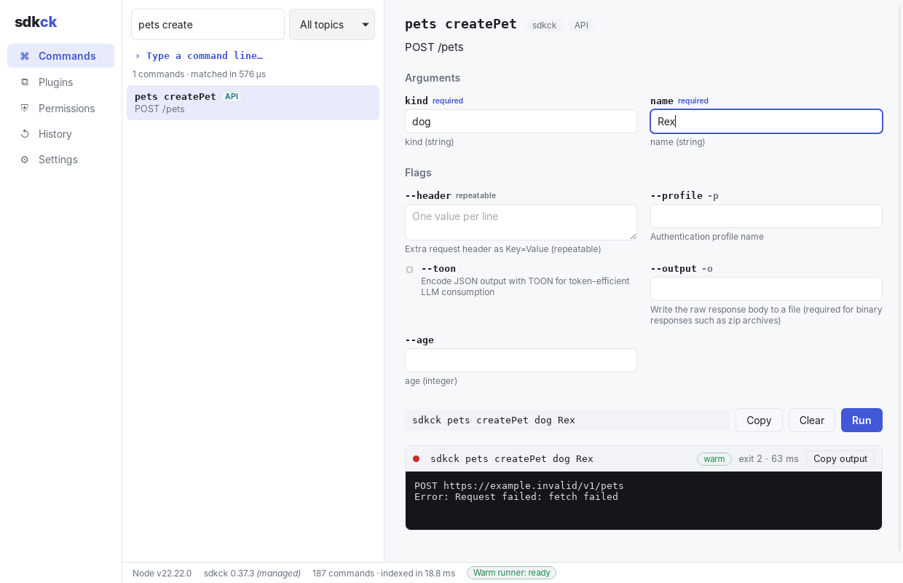

# sdkck Desktop

A desktop app for [sdkck](https://github.com/hesedcasa/sdkck): install it, manage its plugins, and browse, search and run every command — plugin commands, imported APIs and MCP tools — from a form-based UI instead of a terminal.



Built with [Tauri](https://tauri.app): a Rust core and a small React UI. The app keeps sdkck's plugin model as it is. Plugins are ordinary sdkck (oclif) plugins, installed into the same data directory the CLI uses, so the CLI sees everything the app installs and the app sees everything the CLI installs.

## What it does

- **Guided setup.** Finds Node.js 22+ (on PATH, or through Homebrew, nvm, volta, fnm or the Windows installer). It installs sdkck into the app's own folder unless a global install already exists. Then you pick the plugins you want from a checklist.
- **Commands.** Fuzzy search runs on every keystroke. You can filter by topic. Each command gets a form generated from its args and flags (required markers, option dropdowns, repeatable flags). Output streams in as the command runs. You can stop a run, and "copy as terminal command" gives you the matching CLI line. A raw command line works too.
- **Plugins.** See installed, bundled and ready-to-install (JIT) plugins. You can install, uninstall and update them, search npm, or install by name or git URL.
- **Permissions.** Edit sdkck's allow/deny rules, test a command against them, and see which commands are currently hidden.
- **History.** Every run is kept with its output, exit code, duration and warm/cold mode, and you can run it again.
- **Settings.** Extra environment variables for commands (API keys, `SDKCK_*`, `AGENT_VAULT_*`), import of your login shell's environment, Node/sdkck overrides, the warm runner toggle, and shortcuts to sdkck's folders.

## Why it's faster

sdkck's plugins are TypeScript, so running a plugin command still needs Node. Most of what the CLI spends time on, though, is not the command itself. Every `sdkck …` call boots Node, loads oclif and every plugin manifest, and then runs the command. The app replaces that overhead in Rust:

| Operation | sdkck CLI | sdkck Desktop |
| --- | --- | --- |
| List every command (`sdkck commands --json`) | ~2,100 ms | **~5 ms** to build the catalog natively from oclif manifests and stores; **~0.02 ms** to revalidate it |
| Search commands (`sdkck search "jira issue"`) | ~750 ms | **~0.1 ms** (nucleo fuzzy matcher in Rust) |
| Check a permission rule | a Node process | in-process (Rust port of `@hesed/permission`'s rule engine) |
| Run `sdkck version` | ~650 ms | **~25 ms** (warm runner) |
| Run `sdkck jira --help` | ~560 ms | **~40 ms** (warm runner) |
| Run an MCP tool (`fixture echo`) | ~870 ms | **~70 ms** (warm runner) |

Measured on Linux x64 with Node 22. CLI times are wall-clock for the whole process. App times come from `cargo run --release -p sdkck-core --example bench`.

**Native catalog.** The Rust core reads the same files oclif does: the root package's `oclif.manifest.json`, the bundled plugins' manifests, the data directory's `package.json` plus each installed plugin's manifest, the `api-<name>.json` and `mcp-client-<name>.json` stores (which produce the same dynamic commands, args and flags that `@hesed/api2cli` and `@hesed/mcp-client` register), and `permission.json`. The result matches `sdkck commands --json` exactly, except that the app keeps aliases on their command instead of listing them as separate rows. The catalog is cached and revalidated with a few `stat` calls, so it rebuilds only after something changes.

**Warm runner.** One Node process starts in the background with sdkck's oclif, plugins and module graph loaded. Each run goes through oclif's own `run()`, the same entry point as `bin/run.js`, so the init and prerun hooks (permission enforcement, telemetry, file logging) still run on every command. A run never waits for this worker. If it is still booting, busy or has crashed, the command runs cold instead (`node bin/run.js …`, exactly what the CLI does). The worker restarts automatically whenever a run changes what sdkck loads, such as a plugin install, `api import` or `mcp client add`.

These always run cold:

- plugin management (`plugins …`)
- long-lived servers (`mcp start`, `webui`)
- the first run of a JIT plugin's command, which installs that plugin
- **every** command while sdkck's Agent Vault interception is configured. Interception works by re-executing the command in a proxied process, which a shared worker can't do, so the app keeps the CLI's fail-closed behavior.

## Install

Download an installer from the [Build desktop app](../../actions/workflows/build-app.yml) workflow's artifacts (`.dmg`, `.msi`/`.exe`, `.deb`/`.AppImage`/`.rpm`). Builds are not code-signed yet.

You need **Node.js 22 or newer**. If it's missing, the app links you to the download.

## Development

```sh
npm install
npm run app:dev        # Tauri dev window with Vite hot reload
npm run app:build      # release installers under target/release/bundle
```

On Linux, Tauri needs WebKitGTK:

```sh
sudo apt-get install libwebkit2gtk-4.1-dev libgtk-3-dev librsvg2-dev libsoup-3.0-dev libjavascriptcoregtk-4.1-dev
```

Tests:

```sh
cargo test --workspace                 # core: catalog, permissions, paths, runner (cold)
SDKCK_TEST_ROOT=/path/to/node_modules/sdkck cargo test -p sdkck-core --test warm   # warm runner against a real sdkck
npm test                               # UI argv/quoting helpers
cargo run --release -p sdkck-core --example bench -- jira --help   # timings
```

### Layout

| Path | What |
| --- | --- |
| `crates/sdkck-core/` | The native core: `paths` (oclif dir resolution), `catalog` + `dynamic` (manifests, API/MCP stores), `search`, `permission`, `agent_vault` (interception detection), `runtime` (Node/sdkck discovery and install), `runner` (cold + warm execution), `engine` (the facade the app calls) |
| `crates/sdkck-core/worker/worker.mjs` | The warm runner, embedded in the binary |
| `src-tauri/` | Tauri shell: thin `#[tauri::command]` wrappers over `Engine`, run output pushed as `run-event` events |
| `ui/` | React UI (Vite) |

## License

Apache-2.0
